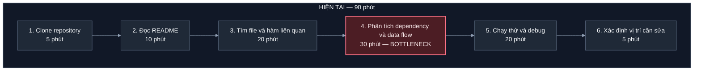
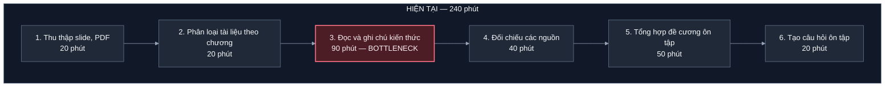
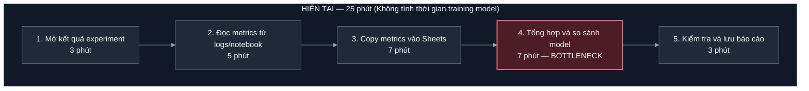

# Báo cáo cá nhân — 2A202603793_DoMinhThanh

> Đối chiếu nội dung nhóm với bảng tính [3 cards](https://docs.google.com/spreadsheets/d/1tuysS72h8ppkgcZ_ZOAsRUt2-Rr6lKC585fAPVwCIKo/edit?gid=388214724#gid=388214724). Các mục tiêu trước/sau là kỳ vọng của nhóm, chưa phải kết quả đo của pilot.

## 1. Thông tin học viên

- Họ tên: Đỗ Minh Thanh
- MSSV: 2A202603793
- Email trường (không bắt buộc, repo có thể để public): Không cung cấp.
- Tên nhóm: Chưa ghi tên chính thức trong tài liệu; nhóm gồm Hiếu, Thanh, Hải và Quân.
- Link repo nhóm: [K5-L3B-Day02-H2-DiscoveryProblemFraming](https://github.com/tran-hai21/K5-L3B-Day02-H2-DiscoveryProblemFraming)

---

## 2. Scan problem (CP1)

Lăng kính: **Lặp lại** · **Tốn thời gian** · **Cần đọc, tổng hợp nhiều thông tin** · **Pain từ người khác**.

|    # | Lăng kính                         | Job Story: Khi… tôi muốn… để…                                                                                                                                | Ai chịu ảnh hưởng?  | Dấu hiệu thật                                                                                             |
| ---: | --------------------------------- | ------------------------------------------------------------------------------------------------------------------------------------------------------------ | ------------------- | --------------------------------------------------------------------------------------------------------- |
|    1 | Cần đọc, tổng hợp nhiều thông tin | Khi tiếp nhận một codebase sẵn, tôi muốn hiểu nhanh kiến trúc và luồng xử lý dữ liệu, để biết chính xác cần sửa code ở đâu.                                  | Developer           | Mất khoảng 1–2 giờ đọc code, lần theo các hàm và luồng dữ liệu trước khi bắt đầu sửa một task.            |
|    2 | Cần đọc, tổng hợp nhiều thông tin | Khi ôn thi, tôi muốn tổng hợp kiến thức từ slide, giáo trình và bài giảng, để không bỏ sót nội dung quan trọng.                                              | Sinh viên           | Mỗi môn có 8–12 chương, mất 3–5 giờ tổng hợp tài liệu ôn tập.                                             |
|    3 | Tốn thời gian                     | Khi nhận một dataset văn bản mới, tôi muốn tự động phát hiện dữ liệu trùng, thiếu hoặc sai định dạng, để không phải kiểm tra từng mẫu thủ công.              | AI, Data Engineer   | Dataset 5.000 mẫu mất khoảng 1–2 giờ để kiểm tra dữ liệu trùng, thiếu hoặc sai định dạng.                 |
|    4 | Lặp lại                           | Khi thay đổi prompt, tôi muốn tự động chạy lại bộ test case và so sánh với phiên bản trước, để biết prompt mới có thực sự tốt hơn không.                     | AI, Prompt Engineer | Mỗi lần sửa prompt phải chạy lại 20–30 test case, mất khoảng 15–25 phút để so sánh kết quả.               |
|    5 | Pain từ người khác                | Khi mentor review code và yêu cầu chỉnh sửa, tôi muốn hiểu rõ nguyên nhân và cách sửa từng comment, để tránh lặp lại cùng một lỗi.                           | Mentor              | Mỗi PR có khoảng 3–5 comment cần làm rõ, mất thêm 20–30 phút để hiểu và chỉnh sửa.                        |
|    6 | Tốn thời gian                     | Khi gặp lỗi trong pipeline NLP, tôi muốn xác định nhanh lỗi đến từ preprocessing, embedding, model hay API, để giảm thời gian debug.                         | AI Engineer         | Mỗi lỗi mất khoảng 30–60 phút để kiểm tra log và xác định lỗi nằm ở bước nào.                             |
|    7 | Lặp lại                           | Khi thử nghiệm nhiều model, tôi muốn tự động lưu accuracy, precision, recall, F1, latency và cost, để không phải ghi kết quả thủ công.                       | AI Engineer         | Mỗi lần thử 3–5 model phải tổng hợp các metrics thủ công, mất khoảng 20–30 phút.                          |
|    8 | Lặp lại                           | Khi đến buổi báo cáo tiến độ, tôi muốn có sẵn danh sách task đã làm, lỗi gặp phải và kết quả đạt được, để không phải tổng hợp lại từ Git và ghi chú cá nhân. | Mentor              | Mỗi ngày mất khoảng 10–15 phút xem lại Git commit, task và ghi chú để chuẩn bị báo cáo.                   |
|    9 | Tốn thời gian                     | Khi model dự đoán sai, tôi muốn biết những mẫu sai thuộc nhóm nào và nguyên nhân có thể là gì, để không phải kiểm tra từng prediction.                       | AI Engineer         | Mỗi lần evaluation có khoảng 50–100 prediction sai cần kiểm tra, mất 30–60 phút phân nhóm nguyên nhân.    |
|   10 | Pain từ người khác                | Khi yêu cầu dự án thay đổi giữa chừng, tôi muốn biết những phần code, prompt, dataset và test case bị ảnh hưởng, để không bỏ sót khi cập nhật.               | AI Engineer         | Mỗi change request phải kiểm tra lại 3–5 thành phần (code, prompt, dataset, test), mất khoảng 30–60 phút. |

**Nếu có dùng AI để gợi ý thêm:** ý nào AI gợi ý mà bạn giữ lại, ý nào bỏ và vì sao.

- Tôi tự tìm ý tưởng, xác định các vấn đề và chọn top 3. AI hỗ trợ đưa nội dung vào đúng bảng của báo cáo, chỉnh cách trình bày và chuyển mô tả quy trình sang Mermaid.
- Không ghi nhận ý tưởng mới nào do AI đề xuất được đưa vào danh sách. Tôi giữ quyền lựa chọn vấn đề, đánh giá tính phù hợp và quyết định nội dung cuối cùng.
- Các con số ở phần scan và Problem Cards là ước lượng ban đầu để mô tả mức độ tốn thời gian; chưa có log đo hay kết quả kiểm chứng riêng cho từng candidate cá nhân.

---

## 3. Top 3 Problem Cards + quy trình nháp (CP2)

### Bảng chọn top 3

| Rank | Problem                          | Vì sao chọn                                                                                                                                                  | Điều còn chưa chắc                                                                                                                          |
| ---: | -------------------------------- | ------------------------------------------------------------------------------------------------------------------------------------------------------------ | ------------------------------------------------------------------------------------------------------------------------------------------- |
|    1 | #1 – Khó hiểu codebase có sẵn    | Mất 1–2 giờ để hiểu kiến trúc, tìm các hàm liên quan và xác định vị trí cần sửa. Thường gặp khi tham gia dự án mới, có tiềm năng ứng dụng AI Code Assistant. | AI có hiểu đúng dependency và luồng xử lý của codebase lớn không? Có giảm thời gian hơn so với IDE và công cụ tìm kiếm code hiện tại không? |
|    2 | #2 – Tổng hợp tài liệu ôn thi    | Sinh viên phải đọc slide, giáo trình và ghi chú từ nhiều nguồn, mất khoảng 3–5 giờ/môn. Có thể áp dụng cho nhiều môn học.                                    | AI có tổng hợp đầy đủ, chính xác nội dung không? Có bỏ sót kiến thức quan trọng hoặc tạo thông tin sai không?                               |
|    3 | #7 – Tổng hợp kết quả experiment | Mỗi lần thử 3–5 model mất khoảng 20–30 phút tổng hợp metrics. Công việc có cấu trúc rõ ràng, lặp lại và dễ tự động hóa.                                      | Có thể chuẩn hóa định dạng log của các model không? Có cần AI hay chỉ cần Python script và MLflow?                                          |

### Problem Card #1 – Hiểu codebase có sẵn

| Trường                                    | Nội dung                                                                                                                                                                                                                                               |
| ----------------------------------------- | ------------------------------------------------------------------------------------------------------------------------------------------------------------------------------------------------------------------------------------------------------ |
| Job Story                                 | Khi tiếp nhận một codebase có sẵn, tôi muốn hiểu nhanh kiến trúc và luồng xử lý dữ liệu, để biết chính xác cần sửa code ở đâu.                                                                                                                         |
| Actor                                     | Developer, AI Intern, AI Engineer                                                                                                                                                                                                                      |
| Thời điểm / bối cảnh                      | Khi mới tham gia dự án, nhận task sửa bug, bổ sung tính năng hoặc làm việc với module chưa quen thuộc.                                                                                                                                                 |
| Quy trình hiện tại (3–7 bước)             | 1. Clone repository từ GitHub/GitLab. 2. Đọc README và cấu trúc thư mục. 3. Tìm các file và hàm liên quan đến task. 4. Lần theo function calls và data flow. 5. Chạy thử hoặc debug để kiểm tra cách hoạt động. 6. Xác định vị trí code cần chỉnh sửa. |
| Bottleneck (bước nào, mất bao nhiêu phút) | Bước 3–5: Mất khoảng 60–120 phút để đọc code, lần theo dependency và hiểu luồng dữ liệu.                                                                                                                                                               |
| Impact (nếu không giải thì sao)           | Chậm tiến độ task, dễ sửa sai vị trí, ảnh hưởng các module khác và phụ thuộc vào mentor để giải thích.                                                                                                                                                 |
| Success metric (baseline → target)        | Thời gian hiểu codebase và xác định vị trí cần sửa: 90 phút → 30 phút (mục tiêu giảm khoảng 67%). Đồng thời theo dõi tỷ lệ xác định đúng file/hàm liên quan.                                                                                           |
| Phương án không dùng AI                   | Viết tài liệu kiến trúc, bổ sung README, sơ đồ data flow; sử dụng IDE Find Usages, Call Hierarchy và công cụ phân tích dependency.                                                                                                                     |
| Giả thuyết về AI (nếu có)                 | AI sử dụng RAG kết hợp phân tích AST để truy xuất code, giải thích chức năng các module, mô tả data flow và chỉ ra file/hàm liên quan kèm tham chiếu.                                                                                                  |
| Cảm nhận nhanh                            | Agent – AI cần tìm kiếm, phân tích nhiều file và liên kết thông tin giữa các module.                                                                                                                                                                   |

Quy trình nháp hiện tại:

### Problem Card #2 – Tổng hợp tài liệu ôn thi

| Trường                                    | Nội dung                                                                                                                                                                                                                                          |
| ----------------------------------------- | ------------------------------------------------------------------------------------------------------------------------------------------------------------------------------------------------------------------------------------------------- |
| Job Story                                 | Khi ôn thi, tôi muốn tổng hợp kiến thức từ slide, giáo trình và bài giảng, để không bỏ sót nội dung quan trọng.                                                                                                                                   |
| Actor                                     | Sinh viên, đặc biệt là sinh viên ngành AI                                                                                                                                                                                                         |
| Thời điểm / bối cảnh                      | Trước kỳ thi giữa kỳ, cuối kỳ hoặc khi cần ôn tập nhiều chương trong thời gian ngắn.                                                                                                                                                              |
| Quy trình hiện tại (3–7 bước)             | 1. Tải slide, giáo trình và tài liệu từ LMS. 2. Phân loại tài liệu theo chương. 3. Đọc và đánh dấu kiến thức quan trọng. 4. Đối chiếu các nguồn để bổ sung nội dung còn thiếu. 5. Viết lại bản tóm tắt và công thức. 6. Tự tạo câu hỏi để ôn tập. |
| Bottleneck (bước nào, mất bao nhiêu phút) | Bước 3–5: Mất khoảng 3–5 giờ/môn để đọc, đối chiếu và tổng hợp tài liệu từ 8–12 chương.                                                                                                                                                           |
| Impact (nếu không giải thì sao)           | Tốn thời gian ôn tập, dễ bỏ sót kiến thức, ghi chú trùng lặp và không đủ thời gian luyện bài tập.                                                                                                                                                 |
| Success metric (baseline → target)        | Thời gian tổng hợp tài liệu: 4 giờ → 1 giờ/môn (mục tiêu giảm 75%). Tỷ lệ bao phủ các mục trong đề cương đạt ít nhất 95%.                                                                                                                         |
| Phương án không dùng AI                   | Sử dụng đề cương chuẩn, template ghi chú, mind map và chia sẻ tài liệu tổng hợp giữa các sinh viên.                                                                                                                                               |
| Giả thuyết về AI (nếu có)                 | AI sử dụng RAG để đọc slide, PDF, giáo trình; tự động tổng hợp theo đề cương, trích dẫn nguồn, giải thích công thức và tạo flashcard/câu hỏi ôn tập.                                                                                              |
| Cảm nhận nhanh                            | Workflow + AI – Có thể tự động hóa quy trình xử lý tài liệu, sử dụng LLM để tóm tắt và tạo câu hỏi.                                                                                                                                               |

Quy trình nháp hiện tại:

### Problem Card #3 – Tự động tổng hợp kết quả Experiment

| Trường                                    | Nội dung                                                                                                                                                                                                                      |
| ----------------------------------------- | ----------------------------------------------------------------------------------------------------------------------------------------------------------------------------------------------------------------------------- |
| Job Story                                 | Khi thử nghiệm nhiều model, tôi muốn tự động lưu accuracy, precision, recall, F1, latency và cost, để không phải ghi kết quả thủ công.                                                                                        |
| Actor                                     | AI Engineer, ML Engineer, AI Intern                                                                                                                                                                                           |
| Thời điểm / bối cảnh                      | Khi thực hiện thí nghiệm NLP, so sánh các model hoặc thay đổi hyperparameter để tối ưu hiệu năng.                                                                                                                             |
| Quy trình hiện tại (3–7 bước)             | 1. Chọn model và cấu hình hyperparameter. 2. Chạy training/evaluation. 3. Đọc metrics từ terminal hoặc notebook. 4. Copy kết quả vào Excel/Google Sheets. 5. Lặp lại với các model khác. 6. Tổng hợp bảng và so sánh kết quả. |
| Bottleneck (bước nào, mất bao nhiêu phút) | Bước 3–4 và 6: Mất khoảng 20–30 phút mỗi đợt thử nghiệm 3–5 model để ghi lại và tổng hợp metrics thủ công.                                                                                                                    |
| Impact (nếu không giải thì sao)           | Dễ nhập sai số liệu, thất lạc kết quả, khó tái lập experiment và mất thời gian so sánh model.                                                                                                                                 |
| Success metric (baseline → target)        | Thời gian tổng hợp kết quả: 25 phút → 5 phút/đợt (mục tiêu giảm 80%). Tỷ lệ experiment được ghi log đầy đủ đạt 100%.                                                                                                          |
| Phương án không dùng AI                   | Sử dụng Python logging, CSV/JSON, MLflow, Weights & Biases hoặc TensorBoard để tự động ghi nhận metrics.                                                                                                                      |
| Giả thuyết về AI (nếu có)                 | AI đọc experiment logs, tự động tạo bảng so sánh, phân tích trade-off giữa accuracy, latency và cost, sau đó gợi ý cấu hình nên thử tiếp.                                                                                     |
| Cảm nhận nhanh                            | Workflow – Ghi metrics nên tự động hóa bằng công cụ thông thường; AI chỉ cần thiết nếu muốn phân tích và đưa ra nhận xét.                                                                                                     |

Quy trình nháp hiện tại:

### Card muốn pitch nhất

- Card số: #1 – Hiểu codebase có sẵn, đứng đầu bảng chọn top 3 cá nhân; tương ứng candidate #4 trong bảng pitch của nhóm.
- Vì sao: Actor và quy trình rõ, phù hợp với công việc kỹ thuật; thời gian tìm file, lần dependency và hiểu data flow có thể đo để so sánh trước/sau.
- Câu hỏi muốn nhóm phản biện: Làm thế nào kiểm tra công cụ chỉ đúng file/hàm trong codebase lớn, và có thực sự giảm thời gian so với IDE, Find Usages hoặc Call Hierarchy?

### AI đã phản biện card thế nào

Các nhận xét dưới đây là rà soát của AI khi hoàn thiện báo cáo, không phải câu hỏi trong buổi pitch. Phản biện tại CP3 đến từ các thành viên nhóm, được ghi ở mục 4.

| Điểm yếu AI chỉ ra                                                                                                   | Đồng ý?                                                     | Đã sửa gì                                                                                                |
| -------------------------------------------------------------------------------------------------------------------- | ----------------------------------------------------------- | -------------------------------------------------------------------------------------------------------- |
| Đọc nhiều file chưa đủ để kết luận cần Agent; có thể bắt đầu bằng tìm kiếm code và một Workflow có các bước cố định. | Đồng ý; nhãn Agent trong Card #1 chỉ là cảm nhận ban đầu.   | Giữ đây là giả thuyết cần so sánh, chưa chốt mức can thiệp cho candidate cá nhân.                        |
| Thời gian baseline và target đang là ước lượng, chưa có phép đo chứng minh hiệu quả.                                 | Đồng ý.                                                     | Ghi rõ trạng thái ước lượng ở mục 2 và phân biệt mục tiêu pilot với kết quả thực nghiệm ở mục 4.         |
| Ghi và tổng hợp metrics có thể giải quyết bằng logging hoặc MLflow, chưa có lý do bắt buộc dùng LLM.                 | Đồng ý; đây cũng là điểm Hải phản biện trong tài liệu nhóm. | Tách tự động ghi metrics khỏi phần AI phân tích kết quả; không coi AI là điều kiện bắt buộc của Card #3. |

---

## 4. Tôi đã tham gia phần nào (CP3 → CP7)

| Hoạt động                  | Tôi đã làm gì?                                                                                                                                                                                            | Kết quả / ảnh hưởng tới bài nhóm                                                                                                                                                                                                          |
| -------------------------- | --------------------------------------------------------------------------------------------------------------------------------------------------------------------------------------------------------- | ----------------------------------------------------------------------------------------------------------------------------------------------------------------------------------------------------------------------------------------- |
| Pitch Problem Card         | Tự chuẩn bị và trình bày 3 vấn đề: hiểu codebase, tổng hợp tài liệu ôn thi và tổng hợp metrics experiment.                                                                                                | Đóng góp candidate #4, #5, #6 trong bảng pitch CP3; làm rõ actor, bottleneck và phương án không dùng AI.                                                                                                                                  |
| Phản biện bài của bạn khác | Hỏi Hiếu về độ mới của dữ liệu ngập; hỏi Hải cách đảm bảo nhận xét đúng từng học sinh khi giáo viên chỉ có ít thời gian rà soát; hỏi Quân về nguy cơ AI bịa số liệu paper và thời gian đối chiếu PDF gốc. | Đặt trọng tâm vào chất lượng dữ liệu và chi phí kiểm tra đầu ra. Với candidate học bạ, câu hỏi của tôi liên quan trực tiếp đến yêu cầu giáo viên duyệt từng em.                                                                           |
| Nhận phản biện             | Hiếu hỏi AI có chỉ đúng vị trí cần sửa trong codebase lớn không; Quân hỏi cách tránh bỏ sót hoặc tóm tắt sai tài liệu; Hải hỏi vì sao cần AI khi đã có MLflow/Weights & Biases.                           | Làm rõ các điều còn chưa chắc: phải kiểm tra độ chính xác, có nguồn đối chiếu và so sánh với công cụ thông thường trước khi chọn AI.                                                                                                      |
| Gom cluster / cây OST      | Đưa 3 candidate cá nhân vào phần thảo luận hội tụ; cả 3 được xếp trong cluster B cùng bài toán paper và tìm lại lời giải Discord.                                                                         | Cluster B có pattern chung là đọc, lọc và đối chiếu thông tin kỹ thuật phân tán. OST của nhóm phân biệt nhu cầu với các giải pháp như chatbot hay RAG.                                                                                    |
| Chọn candidate problem     | Tham gia đối chiếu các candidate theo actor, quy trình, bằng chứng, impact và phạm vi lab.                                                                                                                | Nhóm chọn candidate #7 của Hải về nhận xét học bạ: 34/35 điểm, so với paper 30/35 và phân loại rác 24/35. Candidate được chọn là quyết định chung của nhóm.                                                                               |
| Kiểm chứng / research      | Tổng hợp và đối chiếu thông tin khảo sát trong tài liệu nhóm để xác định pain chính, tín hiệu xác nhận và lo ngại của giáo viên; so sánh hướng Excel/Mail Merge, tính năng sẵn có và chat AI thủ công.    | Tài liệu CP4 ghi 3 cuộc phỏng vấn và 22 câu trả lời khảo sát. Tôi sử dụng kết quả nhóm ghi nhận, không nhận toàn bộ phỏng vấn là công việc cá nhân. Trọng tâm là giảm công soạn lời nhận xét, vẫn giữ việc đánh giá và duyệt ở giáo viên. |
| Quy trình nhóm             | Đối chiếu quy trình 5 bước trước/sau với bottleneck và các bên thực hiện được ghi ở CP5.                                                                                                                  | Phân biệt tổng thời gian hiện tại 480 phút/lớp với riêng bước soạn nhận xét 360 phút; quy trình tương lai đặt mục tiêu 45 phút, gồm 20 phút giáo viên rà soát. Đây là mục tiêu cần đo trong pilot.                                        |
| Problem Statement          | Đối chiếu actor, bottleneck, metric và boundary từ v0 sang v1 theo tài liệu nhóm.                                                                                                                         | V1 chuyển từ chat từng học sinh sang luồng xử lý theo bảng; AI chỉ tạo bản nháp từ dữ liệu đã trích xuất, giáo viên duyệt trước khi xuất.                                                                                                 |
| Mức can thiệp AI           | Xem xét No AI, Rule, Workflow và Agent dựa trên bước cần xử lý ngôn ngữ và trách nhiệm duyệt của giáo viên.                                                                                               | Nhóm chọn Workflow: Rule tiền xử lý → AI sinh nháp → giáo viên duyệt → Rule xuất file. Không giao AI tự quyết định nội dung cuối hoặc tự ghi vào học bạ.                                                                                  |
| Quyết định                 | Đối chiếu kết luận và ngưỡng dừng của nhóm với rủi ro sai thông tin đã nêu khi phản biện.                                                                                                                 | Nhóm chốt Go cho pilot: thử 10 học sinh đại diện trước khi đánh giá cả lớp 45 em. Nếu tỷ lệ chấp thuận dưới 65% hoặc xuất hiện thông tin điểm số bịa đặt, dừng phần AI và quay về phương án Rule.                                         |

---

## 5. Dùng AI

Tôi là người tìm ý tưởng, thực hiện phần lớn công việc và đưa ra lựa chọn cá nhân; các kết luận chung do nhóm thống nhất. AI hỗ trợ định dạng báo cáo, chuyển sơ đồ, đối chiếu tài liệu và rà soát cách diễn đạt. Tôi kiểm tra nội dung và quyết định bản nộp cuối cùng.

| Checkpoint                     | Tôi dùng AI để làm gì?                                                                                                            | AI hữu ích ở đâu?                                                                    | AI sai hoặc hời hợt ở đâu?                                                                                         | Tôi sửa gì bằng nhận định của mình?                                                                                            |
| ------------------------------ | --------------------------------------------------------------------------------------------------------------------------------- | ------------------------------------------------------------------------------------ | ------------------------------------------------------------------------------------------------------------------ | ------------------------------------------------------------------------------------------------------------------------------ |
| CP1 Scan                       | Sắp xếp nội dung tôi đã chuẩn bị vào bảng Markdown.                                                                               | Thống nhất cột lăng kính, Job Story, actor và dấu hiệu.                              | Trong bản báo cáo ban đầu, AI chưa phân biệt rõ số ước lượng với dữ liệu đã đo.                                    | Giữ các ý tưởng của tôi; ghi rõ số liệu scan là ước lượng cần kiểm chứng.                                                      |
| CP2 Problem Card               | Chuẩn hóa bảng và sơ đồ; rà soát các điểm chưa chắc khi hoàn thiện báo cáo.                                                       | Tách Job Story, quy trình, bottleneck, metric và phương án không AI để dễ đối chiếu. | Bản đầu còn để trống phần pitch và phản biện; nhãn Agent ở Card #1 chưa có so sánh đủ với mức đơn giản hơn.        | Đối chiếu phản biện thật của Hiếu, Quân, Hải từ bảng tính; giữ nhãn Agent ở mức giả thuyết, không coi là lựa chọn đã chốt.     |
| CP4 Research                   | Đọc tài liệu nhóm và đưa phần liên quan vào báo cáo cá nhân.                                                                      | Tổng hợp các phương án đã ghi và chỉ ra thông tin nguồn còn thiếu.                   | Đọc bảng tổng hợp chưa đủ xác minh khảo sát hoặc tính năng thực tế của từng công cụ.                               | Giữ nguồn nhóm riêng với kiểm chứng độc lập; không nhận là đã tự mở và thử các công cụ, không tạo thêm số liệu phỏng vấn.      |
| CP5 Quy trình                  | Chuyển 3 quy trình nháp cá nhân từ text sang Mermaid và đổi màu tối theo yêu cầu của tôi; đối chiếu quy trình nhóm trong báo cáo. | Hiển thị rõ thứ tự bước, thời gian và bottleneck.                                    | Ban đầu AI dùng khối text thay vì Mermaid; màu nhấn ban đầu còn sáng.                                              | Tôi yêu cầu đổi sang Mermaid rồi dùng màu tối; kiểm tra lại nội dung các bước và thời gian.                                    |
| CP5–6 Problem Statement        | Sắp xếp lại nội dung v0/v1 đã có trong bảng tính vào phần đóng góp cá nhân.                                                       | Giữ nhất quán actor, bottleneck, metric và boundary khi trình bày.                   | AI có thể làm câu chữ đầy đủ hơn trong khi bằng chứng vẫn thiếu; định dạng tốt chưa chứng minh giải pháp hiệu quả. | Dùng nội dung nhóm đã chốt, giữ mục tiêu 45 phút ở trạng thái kỳ vọng; không để AI tự thay quyết định hoặc thêm kết quả pilot. |
| CP6 Mức can thiệp / quyết định | Trình bày lại so sánh 4 mức và kết luận đã ghi của nhóm.                                                                          | Làm rõ vai trò Rule, AI và giáo viên trong Workflow.                                 | Không thể dùng bảng mô tả để khẳng định chi phí, độ an toàn hay chất lượng đã đạt.                                 | Giữ Go ở phạm vi pilot, giữ giáo viên duyệt và ngưỡng dừng; lựa chọn cuối cùng thuộc về tôi và nhóm.                           |

---

## 6. Reflection (CP7)

Trả lời bằng trải nghiệm thật của bạn, tối thiểu 200 từ cho các câu 6.1–6.6 (không tính 6.7, câu này được chấm riêng ở tiêu chí C5). **Không dùng AI để viết thay.**

**6.1. Tôi học được gì khi nghe top 3 problems của các bạn khác?**

Ở problem của 3 bạn còn lại trong team cho tôi thêm góc nhìn khi xác định vấn đề, paintpoit, phân tíchbottleneck trong workflow đánh giá được múc độ ảnh hướng của vấn đề. Đồng thời hiểu rằng không phải chỉ có AI giúp ta xác định được các vấn đề mà cần quan sát và đánh giá nhiều hơn
**6.2. Nhóm có lúc nào bị "solution-first" (nghĩ giải pháp trước khi hiểu vấn đề) không? Lúc đó nhóm nhận ra và xử lý thế nào?**

Có, ở 1 vài case bọn em cũng có những suy nghĩ về giải pháp trước khi nhìn nhận vấn đề như case về so sánh metric khi train model nên đã không năm bắt được toàn bộ vấn đề cần giải quyết của problem dẫn đến thiếu sót trong quá trinh đưa ra giải pháp. Cách xử lý của nhóm là quay lại xem xét lại ván đề gặp phải với các vấn dề đưa ra solution tương ứng.

**6.3. Tôi có đổi ý sau khi bị phản biện không? Kể một lần cụ thể.**

Ví dụ cụ thể để tôi xem lại lựa chọn của mình là câu hỏi của Hải: tại sao cần AI cho experiment khi MLflow hoặc Weights & Biases đã hỗ trợ ghi log và so sánh?câu hỏi rõ rằng pain có thật không đồng nghĩa với việc cần LLM. Với phần ghi metrci để so sánh khi train model cũng vậy, phần ghi metrics nên ưu tiên công cụ thông thường; AI chỉ là hướng bổ sung nếu việc phân tích kết quả thực sự cần thiết.
**6.4. Kết quả kiểm chứng (phỏng vấn/survey/research) có làm tôi bất ngờ không? Điều gì?**

Phần kiểm chứng phỏng vấn làm em thấy bất ngờ là có rất nhiều người lo  AI dùng lời không đúng thực tế hoặc việc tải dữ liệu học sinh lên công cụ online. Điều này có thể cho thấy người đùng không chỉ muốn 1 sẩn phẩm AI hoàn thành nhanh công viêc mà còn phải hoàn thành chính xác với các task đucowj giao.
**6.5. Điều khó nhất khi viết Problem Statement là gì?**

Điều khó khăn nhất là tổng hợp khảo sát rồi xác định đúng vấn đề cần giải, thay vì liệt kê nhiều khó khăn hoặc viết ngay tên giải pháp. Cần nối actor, bối cảnh, bottleneck và tác động thành một vấn đề cụ thể, Boundary cũng phải đi cùng vấn đề: AI gợi ý lời văn từ dữ liệu có sẵn, giáo viên vẫn đánh giá và chốt nội dung.

**6.6. Nếu làm lại, tôi sẽ đổi gì? Tôi sẽ phản biện nhóm mạnh hơn ở điểm nào?**

Nếu làm lại, tôi sẽ xác định rõ vấn đề và cách tính baseline ngay từ đầu để việc tổng hợp rõ hơn.Khi phản biện nhóm, tôi sẽ hỏi kỹ hơn cách xác định một nhận xét là đúng và cá nhân hóa, ai kiểm tra.

**6.7. Hiểu bài:** giải thích bằng 5–8 câu, không nhìn tài liệu, chuỗi *problem → quy trình → metric → boundary → mức can thiệp AI → quyết định* của bài nhóm mình.

Problem nhóm chọn là giáo viên chủ nhiệm mất nhiều thời gian soạn nhận xét học bạ riêng cho lớp 40–45 học sinh trước hạn khóa sổ. Quy trình hiện tại gồm xuất dữ liệu, phân loại, soạn nhận xét, rà soát và nhập vào hệ thống. Nhóm theo dõi độ chính xác và tỷ lệ giáo viên chấp thuận; đây là mục tiêu pilot, chưa phải kết quả đã đạt. Boundary là hạn chế dữ liệu định danh gửi tới AI, không tự sinh nhận xét cho trường hợp đặc biệt và không tự ghi dữ liệu vào học bạ khi giáo viên chưa xác nhận. Nhóm chọn Workflow vì các bước đã xác định được, Rule xử lý dữ liệu và xuất file, AI hỗ trợ diễn đạt còn giáo viên duyệt nội dung. Quyết định là Go cho pilot nhỏ với 10 học sinh đại diện rồi đánh giá trên lớp 45 em.

---

## 7. Tài liệu tham khảo

- [Worksheet của buổi học](../../docs/01-worksheet.md), [quy định sử dụng AI](../../RULES.md) và [rubric chấm bài](../../RUBRIC.md): cấu trúc báo cáo, yêu cầu nguồn bằng chứng và giới hạn hỗ trợ AI ở Reflection.
